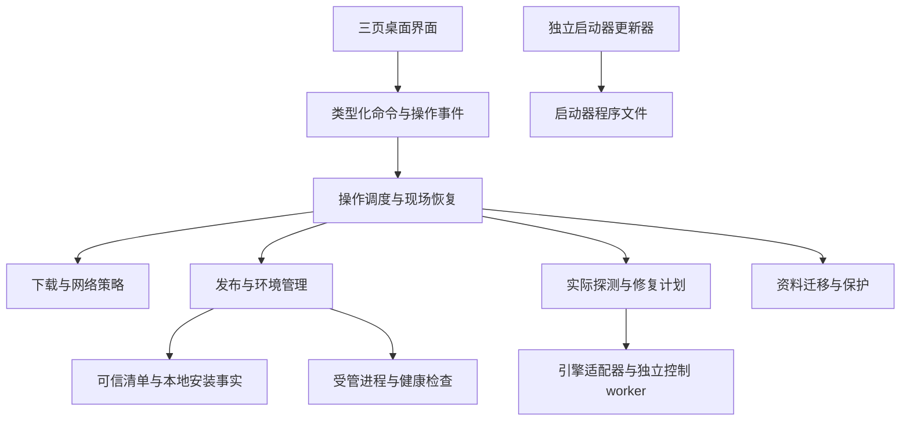

# 桌面启动器后续设计书（审核稿）

## 0. 当前修订：CR-001（2026-10-29）

用户对缺少合适CUDA测试机明确回复“没有合适机器，跳过这个测试”。按[CR-001完整授权与逐项边界](../tasks/desktop-launcher-full-plan/00_预检证据/change-control-governance.md#cr-001用户批准跳过受资源限制的gpu验收)，Fast因固定驱动不满足的GPU运算/完整模型/短训练/权重、DiffSynth因完整BF16模型显存需求不满足的加载/反向/短训练/权重记录`skip`，不能记pass或宣称四引擎训练实测全部通过。安装/导入/精准修复/隔离/回退和受限硬件诊断继续实现验证；本机可执行的Kohya/Toolkit及DiffSynth普通小张量测试保留。M0独立CUDA准备不再单独重试，相关CUDA证据在对应M2/M3引擎实际配方中取得。

本修订覆盖下文D6、7.4、M2/M3/M5及A6中“所有四引擎GPU必须通过”的测试门；其他架构、健康状态、签名/路径安全及最终同制品干净Windows验收均不豁免。里程碑和最终交付需将授权skip与剩余必测pass分别报告，结论注明GPU验收边界。原0.1事实/失败和未运行证据保留，不追写为成功；实时状态以总控为准。

- 文档版本：0.2，2026-10-29；CR-001为用户批准的GPU实测豁免，架构/产品功能不变。
- 状态更新（2026-10-29）：用户在审核材料交付后明确指令“建立goal目标，开始执行任务书的任务”，已按0.1及推荐方案开始M0；实际执行状态以[完整任务总控](../tasks/desktop-launcher-full-plan/00_总控目标索引.md)为准。下文“本轮/待审核”保留为设计轮历史语境，规格内容不变；真实资料迁移与正式公共发布仍未授权。
- 功能分支：`feat/desktop-launcher`；分支基点：`9ca2de963122f34599e34e5ff382199de9188811`。
- 工作副本：`E:/OpenSourceTeamWork/workspace/branches/dev`。目录名沿用原工作副本，实际 Git 分支已经切换；已有功能改动尚未提交，不代表已写入分支历史。
- 审核入口：[审核决策单](desktop-launcher-next-review.md)。本文件是后续设计的唯一规格来源；已完成的底座计划仍是历史实施记录，不重开或改写其完成状态。

## 1. 本次要审核什么

在 0.2 已验证的独立启动、版本目录和用户资料底座上，补齐 #516 的日常安装与维护能力：**用户只有一个启动器，也能安装训练器；训练器或某个引擎损坏后，能够看见原因、修复对应部分，继续使用或回退。**

本次交付是规格设计与实施顺序，采用规格驱动设计和架构审查。用户审核通过后，再按里程碑细化施工任务、预算和验证资源；不以本设计书替代开工计划，也不提前执行真实迁移、重型下载或 GPU 训练。

平台继续 Windows x64 优先；界面保留“启动、版本管理、环境管理”三页、约 900×600。训练参数、数据集编辑、模型训练和标签编辑仍在训练器网页中完成。

## 2. 事实基线与需求差距

### 2.1 已验证能力

0.2 已验证 Tauri 2 + Vue 3 + Rust、限制 PATH 下的独立 uv/Python、真实 GUI 安装和启动、main/dev 并存切换与回退、profile 保留、三类损坏恢复、状态故障拒绝覆盖以及 Job Object 进程回收。原始证据见 [底座总控](../tasks/desktop-launcher-foundation-plan/00_总控目标索引.md)；详细目录合同见 [安装模型](desktop-launcher-installation-model.md)。

Rust 15 项测试、Python 184 passed / 2 skipped、首轮原生 114 项和最终 EXE 77 项复验均有记录。它们证明当前限定功能；没有证明 GPU 训练、全部引擎安装、干净 Windows、旧安装接管或远端签名更新。

当前清单为固定取样的 main/dev 提交；二者真实 VERSION 都为 `3.3.1-dev`。渠道不等于稳定性认证，分支最新 HEAD 也不自动成为可推荐发布。

### 2.2 #516 对照

| 需求 | 0.2 事实 | 后续设计与完成门 |
| --- | --- | --- |
| 轻量启动器从零安装 | 本机受限 PATH 安装已过 | 首屏预检、完整体积说明、可恢复任务、WebView2 引导、干净系统验收 |
| 分阶段进度、失败重试 | 日志与粗粒度 journal；长命令返回最终报告 | 独立操作身份、结构化进度、取消、下载续传、重启恢复 |
| 自助获取新版本 | 仅内置固定清单 | 签名远端清单、发布日期、实际占用、非阻塞更新发现 |
| 多版本、切换、回退 | 双版本已验证 | 历史 receipt 独立可信；动态清单下继续离线识别和回退 |
| 本体按项诊断与修复 | 源码/整个 GUI venv/基础 Python 分开恢复 | 缺包只补对应依赖闭包，配方漂移可解释，环境重建为后备操作 |
| 引擎逐项检查与修复 | 还没有接入启动器；GUI 健康不代表引擎可训练 | 统一路径/配方/探测合同，按实际文件诊断，先闭环 Kohya 与 Anima Fast，再接 AI Toolkit、DiffSynth |
| 硬件与磁盘 | 未完成逐引擎硬件诊断和峰值空间预估 | 驱动、Torch CUDA 与实际运算分层；缺 GPU 不阻塞打开 GUI |
| 用户资料与旧整合包 | 正式新根资料隔离已过；拒绝接管旧根 | 显式扫描、预览、复制/引用、验证、切换；源安装保留 |
| 启动器独立更新 | 无安装器/自更新 | 独立更新器、壳签名、兼容状态回退、普通用户安装和新电脑验证 |

后两行是产品化补全范围，不冒充 #516 原文逐字要求；旧整合包导入和自动自更新的首发程度由审核决策确认。

## 3. 建议锁定的产品决策

1. **保持 Tauri/Vue/Rust 路线和已验证目录合同。** 不重做桌面壳，不改成训练功能平台。
2. **新用户默认 main 发布线，开发线主动选择。** 只有经发布验证的候选才可作为默认；没有合格 main 制品时不默认推荐任何候选，用户可明确选择并确认 dev 风险，或等待正式发布。不伪造稳定版本，也不静默回退到默认安装 dev。此为建议的新行为，0.2 当前默认 dev 不在本次修改。
3. **所有四个指定引擎纳入整体目标，分批交付。** 第一批 Kohya、Anima Fast，第二批 AI Toolkit、DiffSynth；其他已发现引擎显示“待适配”，不能冒充已诊断或未安装。
4. **引擎环境继续按训练器发布隔离。** 先保证回退正确；依赖下载缓存可共享，环境实例不跨发布盲目复用。后续只有配方、ABI、补丁和探测均匹配，才单独讨论环境共享。
5. **首次旧安装导入优先资料和配置。** 原环境可探测但不默认原位接管；可复用旧 venv 的条件另设验收，不能靠复制或目录存在判定。
6. **先完成诊断与修复价值，再做发布自动化。** 三页 UI 改进随功能交付，不先投入与故障恢复无关的视觉改造。

具体可选项及影响集中在[审核决策单](desktop-launcher-next-review.md)，本节不视作用户已批准。

## 4. 架构与职责边界

| 模块 | 职责 | 明确禁止 |
| --- | --- | --- |
| UI/IPC | 展示事实、提交明确动作、接收事件 | 从日志文字推断成功；传任意 URL/命令让后端执行 |
| OperationManager（操作管理器） | 持久操作、阶段、取消、资源锁、重试与恢复 | 长时间持有整个 Engine 锁，导致取消命令排队失效 |
| ArtifactStore（制品存储） | 下载、续传、大小与完整哈希校验、缓存 | partial 直接作为安装事实；换源后降低校验要求 |
| ReleaseManager（发布管理器） | receipt、源码、选择、回退与健康历史 | 以最新远端列表取代本地历史，或安装成功就标健康 |
| Diagnostics/Repair（诊断/修复） | 观察事实、生成变更计划、只改所需组件 | 自动整包重装；把超时/权限失败显示为“未安装” |
| EngineAdapter（引擎适配器） | 解释各引擎路径、配方、探测和最小修复能力 | 桌面端和网页端各维护一套互相冲突的安装逻辑 |
| ProfileService（资料服务） | 共享资料、按版本状态、迁移与快照 | 修代码时搬走 profile；删除版本时删除数据或外部引用 |
| LauncherUpdater（壳更新器） | 独立验证、等待退出、替换与失败恢复 | 依赖训练器 Python，或与训练器回退共用一个事务 |

文件拆分是建议：从现有 `core.rs` 按上述职责渐进提取，保留已验证的路径守护、原子写入、Job 归属和健康检查。不先进行脱离用户流程的大规模重构。

## 5. 操作、事务与可恢复安装

### 5.1 独立操作身份与接口

现有 `journal-<release-id>.json` 只有四阶段，且源码与环境复用同一记录；只能作为中断提示。新增 `state/operations/<operation-id>.json`，保留旧 journal 的兼容读取，不静默覆盖未知版本。

操作记录至少包含：`schema_version / operation_id / kind / target_component / release_id / recipe_digest / catalog_snapshot_digest / attempt / phase / status / sequence / checkpoints / error_code / cancel_requested / timestamps`。日志另外保存并脱敏；事件序号用于断线补读，事件不是磁盘安装事实。

拟定命令：`begin_operation(spec) -> operation_id`、`get_operation(id)`、`list_operations(root)`、`cancel_operation(id)`、`pause_download(id)`、`resume_operation(id)`、`plan_repair(target)`、`execute_repair(plan_id)`。命令参数只允许已验证组件 ID 和计划 ID；计划内容改变后必须重新展示。

长操作 worker 持有工作区 lease，UI 可继续读快照和日志。取消句柄通过独立原子标志或消息通道访问，不等待长操作持有的 Engine Mutex。兼容 CLI 仍可阻塞等待最终报告；新 UI 使用操作 ID。

### 5.2 阶段和结果分开

阶段为 `预检→下载→校验→解压→准备环境→实际验证→提交`；结果状态为 `queued/running/pause_requested/paused/cancel_requested/cancelled/interrupted/failed/succeeded`。阶段百分比不混成虚假的总百分比；缺少总字节时显示不定进度。

| 时点 | 暂停/取消行为 | 重启后处理 |
| --- | --- | --- |
| 下载 | 支持续传的资产可暂停；取消保留可验证缓存 | 核对资产身份、partial、响应验证器，再决定续传或重下 |
| 校验/解压 | 可取消，未提交目录保持隔离 | 从完整资产重新校验或解压，不沿用未经核验的半目录 |
| uv/依赖安装 | 只承诺取消本任务进程；不承诺包管理器内部字节级暂停 | 探测环境实际状态，重试幂等步骤或新建后备实例 |
| 安全提交 | 短时间延迟取消，界面说明“完成安全提交后停止” | 依据 commit intent、receipt、指针核对现场，不能盲信旧阶段 |
| 已成功 | 取消不撤销成功；回退是另一项显式操作 | 保存结果和安装事实 |

初期同一安装根只允许一个变更操作；运行训练器/训练任务时不修改其运行目录或环境。网页安装与桌面安装必须遵守同一跨进程变更锁；不具备该能力的旧发布，运行期间禁止桌面变更。后续并行下载可放开，但提交仍串行。

关闭窗口默认结束本程序管理的训练器和安装子任务；有任务时先说明影响。退出使用与取消一致的安全提交边界，超时保留可恢复意图，不遗留未知后台服务。不增加系统常驻守护进程。

### 5.3 续传与资源预算

partial checkpoint 绑定资产摘要、预期大小、来源、已写字节和 ETag/Last-Modified。只有 `206` 且 Content-Range 起点/总长一致时追加；`200` 重新开始，验证器变化或 `416` 先核对并重下。换镜像仅在相同可信资产和续传验证条件均满足时复用 partial。完成后始终校验完整 SHA256。

下载限制按资产类型设置：源码/工具沿用有限上限；Torch 等大依赖由编译内置的受信任配方，或验签通过的远端配方声明更高预算，不能直接放宽为无限下载。M1/M2 可以依靠内置配方验证和交付，不等待 M3 的远端签名流程；预算仍受阶段任务书和用户资源授权限制。解压同时限制实际写出字节、条目数和压缩比，拒绝路径穿越、链接和文件名冲突。HTTP 声明和 ZIP 声明只用于预检，不能代替实际计量。

预检分卷计算峰值：新增缓存、解压暂存、新环境、保留版本与备份、安全余量。先区分硬链接与普通复制，空间不足时在下载/变更前阻止；依赖体积未解析时显示区间或“待解析”，不把源码 ZIP 大小当成总安装量。

## 6. 网络设置与首次安装

网络入口放首次安装折叠区和“环境管理→网络与下载”，不新增第四个侧栏。支持自动、系统、手动代理、直连；镜像选择独立于代理策略。手动代理失败不得静默改成直连。

主程序完全损坏时，Rust 下载器、uv、Git 和控制 worker 仍能获取同一份标准化网络策略。沿用现有 `mikazuki.networking.policy` 的模式和语义，通过共享测试向量保证 Rust/Python 一致；不要求先导入失效 GUI 包才能解析策略。

启动器私有设置保存在 Tauri 提供的用户应用数据目录；安装根保存无凭据的配置身份。带认证代理凭据使用 Windows 凭据保护，导出日志/诊断包默认排除。任务开始时固定策略快照，改变设置只影响后续任务；本机健康探测始终绕过代理。不修改系统全局代理、Git 配置或用户 PATH。

连接测试分别检查清单、源码、工具/Python、依赖源，区分 DNS、代理连接、TLS、HTTP 拒绝、超时、校验错误。配置源必须提供同一制品哈希；镜像不能决定版本身份或信任根。

首次安装采用页内步骤：位置/发布线→空间和网络预检→复核下载组件→执行→真实验证。默认只装 GUI；训练引擎按用户选择安装，并单独展示重型依赖预算。

## 7. 诊断、精准修复与引擎合同

### 7.1 诊断事实与最小变更

统一 `DiagnosticResult`：组件身份、`ready/missing/damaged/unsupported/unknown/checking`、检查时间、事实、错误码、严重程度、证据位置、是否影响 GUI/特定引擎及可用动作。状态文件缺失不等于未安装；探测超时是 unknown。硬件不可满足时给操作指导，不展示无法执行的“自动修复”。

`RepairPlan` 固定诊断摘要、配方、预期动作、修改/备份路径、下载/磁盘预算、资源锁、回退点与验收器。执行前再核对事实，发生变化则重新计划。UI 显示修复影响，默认只修所需组件：

| 故障 | 默认处理 | 验收 |
| --- | --- | --- |
| receipt/引擎登记丢失，实体完整 | 实际探测后补登记 | 不下载、不重建环境，实际解释器与入口通过 |
| 单个受管源码组件损坏 | 从可信制品恢复该组件 | 哈希和入口通过，资料不变 |
| 缺包或某依赖损坏 | 按锁定配方修对应依赖闭包，展示连带变更 | `pip check`、版本/ABI、关键导入和组件探测通过 |
| 基础 Python 损坏 | 修该自管 Python 实例，再检查引用它的环境 | 归属、版本与受影响环境通过 |
| 环境存在不可解冲突/严重损坏 | 单独提供“重建此环境”后备动作 | 新实例验证后才切换，保留旧实例 |
| 驱动/硬件不满足 | 解释问题并提供官方指导 | 不自动安装驱动，不删除正常环境 |

依赖定点修复不是不受保护的原位 pip 操作：先停止目标使用者、获取锁、保存依赖闭包对应的文件/元数据/入口快照，再持久化 `instance_id + generation + dirty`。旧健康记录只对应旧 generation；开始修改后禁止启动该实例，取消或杀掉包管理器不能将它恢复成健康状态。快照必须独立于将被修改的文件，不用可能被原位写穿的硬链接当备份。

失败或取消时按变更记录恢复到同一绝对路径并重验；无法证明精确恢复则维持 dirty，提供继续修复、经验证的旧绑定回退或显式后备重建。不能把“进程已退出”显示成“环境已恢复”。M1/M2 的故障测试必须覆盖包文件已改变而状态尚未提交的窗口。

变更提交意图记录旧绑定/旧 generation、候选内容摘要和回滚材料。基础 Python 可能被多个 venv 引用，修复前按受管引用表停用并标记整个引用闭包待复验，全部受影响环境验证后分别恢复健康；不只修好 python.exe 就保留其他环境的旧健康结论。

健康环境升级、显式重建使用最终固定路径的新实例，验证后原子切换绑定；原健康实例保留。默认缺包修复仍仅修所需闭包，环境快照/备份不等于重装全部依赖，更不涉及训练源码、模型或其他引擎。

哈希清单也必须验证覆盖范围，不能仅凭可编辑本地清单证明完整。后续发布应从固定制品生成并绑定完整入口/必要资源和依赖锁；外部插件文件与用户内容不并入不可变源码校验。

### 7.2 已发现的路径集成阻塞

当前 `run/<id>/extensions` 联接到 `profile/compat/<id>/extensions`。Anima Fast 的 `environment.py::_resolve_child` 在 resolve 后要求路径仍在 project_root 内，因此会拒绝该联接；同时多个安装器把基础 Python 写在 `project_root/.python`，重建 run 时该目录没有稳定映射。

这是**静态代码可确定的条件冲突，尚未实际运行引擎安装复现**，不能把现有 GUI 健康结果描述成引擎可用。M2 开始前先建立运行目录合同 `RuntimeLayout`：明确 source_root、run_root、profile_root、engine_state_root、base_python_root、environment_instance_root 和允许的物理根；管理布局按固定映射验证，不能简单去掉现有路径安全检查。

新布局把引擎 Python 与环境实例放在稳定的发布专属状态目录，run 只提供兼容映射。已有状态扫描后显式迁移；旧 CLI 未启用新合同继续保持旧路径。没有合同支持的历史发布只支持已验证的 GUI/版本功能，引擎动作标为待适配，不向其源码临时注入补丁。

### 7.3 独立控制通道与复用方式

启动器的基础 Python、GUI 环境与引擎环境是不同层。Rust 负责基础恢复和目录保护；引擎控制 worker（工作进程）使用经过校验的受管基础 Python，依赖尽量限于标准库，不导入 GUI、Torch 或整套 `mikazuki.app` 才能启动。基础 Python 坏时先由 Rust 恢复。

引擎适配器复用现有 manifest/environment/installer 的知识，抽出纯数据配方和探测/计划接口。网页端与桌面端最终调用同一安装执行核心和锁，不维护两套 Torch pin、补丁与修复分支。签名配方只选本程序编译/发布过的动作 ID，不成为远端任意脚本执行器。

每引擎清单需包含：引擎 ID、训练器发布兼容合同、固定上游/补丁摘要、平台、Python ABI、依赖锁摘要、基础工具、必要文件、探测命令 ID、所需 GPU 能力、允许修复动作及后备重建能力。至少分别报告“安装完整”“可导入”“GPU 可用”“最小训练验证”，四者不互相替代。

首批 Kohya + Anima Fast 关闭路径和控制通道风险；随后 AI Toolkit、DiffSynth 必须完成同一合同和真实验证。Musubi、MOSS 等其他已存在的引擎仅在有适配和证据后标支持。

当前实际注册包有七个：Kohya、Anima Fast、AI Toolkit、Musubi、MOSS、Kohaku-MOSS、DiffSynth，均声明为 plugin。普通 Anima LoRA/finetune 由 Kohya 提供，不等于 Anima Fast。各包要求的基础 Python 也不同，当前分别涉及 3.10、3.13、3.11、3.12、3.13、3.12、3.12；适配器读取对应发布配方，不能把 GUI 的 3.10.19 套到所有引擎。

已有 `status/diagnose/preflight/dry-run/install/repair/upgrade/uninstall` 路由，但各引擎能力并不一致。新增版本化 `EngineCapabilities`，明确支持的动作、是否需要 GPU、执行时写入范围和合同版本。不支持的动作要明确返回原因。以 DiffSynth 已有的组件诊断和 surgical repair（按故障部位修复）为合同参考；其他引擎目前有些 repair 仍是 force install（强制安装），必须改造并验证后才能宣传精准修复。

现有部分 status 会修复 `pyvenv.cfg`，部分 preflight/dry-run 会创建配置文件。因此新合同严格区分 `inspect_readonly`（只读采集）、`probe_execute`（受控执行探测）和 `repair_apply`（应用变更），不能把旧 GET/status 直接当成只读入口。只读检查不得自动迁移或修环境；需要产生临时文件的探测走操作记录、明确受管临时目录，并验证检查前后持久数据不变。

Kohya 另有 `main_env` 兼容回退，可将 GUI/主环境判为可用并对其升级；这与启动器的固定 GUI 配方存在所有权冲突。正式受管布局默认只允许 standalone（独立引擎环境），禁止自动向 GUI 环境安装或升级 Torch/训练依赖。旧共享环境显示来源与所有者，只能在显式接管计划中处理；CLI/非受管安装的兼容行为保留，不全局删除。

### 7.4 环境实例与 GPU

Windows venv 不保证可移动。新增/重建环境在最终不变的实例路径创建，以实例指针原子激活，不把任意 staging venv 直接 rename 当成事务发布。已有 `<release>/gui` 作为旧式固定实例兼容读取；引入实例字段时显式升级 registry，保存旧副本，旧启动器不支持新 schema 时拒绝写入。

健康 GUI 可继续打开，即使未安装某个可选引擎。硬件页区分显卡/显存、驱动版本、驱动支持的 CUDA、引擎 Torch 编译 CUDA 和实际小张量运算；没有 `nvcc` 不自动判定不能训练。引擎验收需要合法小模型与数据、明确 GPU 和预算后执行短训练；本审核阶段不下载模型或宣称训练通过。

## 8. 可信远端清单与版本更新

分离三种事实：远端候选快照、本地已验证 receipt/实际文件、当前运行状态。版本下架或联网失败不让已安装历史失去身份，也不影响健康版本离线启动和回退。UI 标清单来源、最后刷新时间、发布日期、实际占用和已验证状态；发布日期来自发布元数据，不能用 commit 时间冒充。

远端清单使用独立版本协议，建议 Ed25519 签名、确定性 JSON 编码，内置公钥作为信任根；包含签名 key ID、发布序号、有效期、最低启动器版本和资产摘要。接受新清单前检查签名、防重放序号、有效期、平台和资料兼容性；密钥轮换需旧可信密钥授权新密钥。可信签名基础设施未具备前，只交付内置清单和手动升级，不开放无签名远端执行。

schema 1 的本地 receipt 保持可读；新远端协议、receipt、registry 分别版本化，不把远端全部字段直接塞进旧的严格结构。现有 `reconcile` 对当前嵌入清单的依赖需扩展为“当时已验证的本地发布记录”，仍须实际验证文件，未知格式拒绝变更。

新 receipt 保留签名原始封套及确定性 payload、摘要、签名 key ID、接受时的可信根/轮换链、序号与时间依据，能够离线重新核验；内置制品则保留所属启动器构建和嵌入清单摘要。不能只保存“verified=true”，也不能凭本地新增文件自授信任。

候选过期、版本下架和安全撤销分开处理：过期/下架停止默认推荐，不否定此前接受的完整本地安装，其离线启动和本地可信资产修复仍可用；新安装或新增信任按当前有效策略处理。收到可验证的安全撤销后，相关资产进入安全保留状态，停止自动安装/激活并提示切到未受影响绑定，不删除资料、不凭网络失败猜测撤销。密钥轮换保留核验历史所需的公钥与证明；主动选择旧版本不能绕过已知撤销规则。

清单签名只证明发布方授权，不等于第三方所有依赖都已独立验签。配方冻结随功能先行：M1 冻结 GUI 配方，M2 冻结首批引擎配方，M3 补齐其余引擎与远端发布。冻结平台相关 Python/wheel/补丁及哈希并记录来源；暂无法锁定或离线复现的引擎标明限制，不宣称同 recipe 能无限期重建一致环境。

更新发现不阻塞启动。安装新发布先准备/验证，不自动改变 current；用户明确选择后再激活，真正启动健康后才写健康历史。主动回退旧版本与接受重放旧清单是两种动作。资料 schema 不兼容时禁止直接切换，先进入资料迁移合同，不能承诺任意版本回退。

## 9. 独立启动器更新与 Windows 分发

训练器更新与启动器更新使用不同资产、签名和事务。启动器更新放版本页单独分组；先验证新壳，准备独立轻量 helper，等待明确 PID 退出，再替换程序文件。helper 不依赖训练器、GUI venv、当前即将覆盖的 EXE 模块，不按进程名杀其他程序。

新壳以操作随机令牌确认自身启动和基本恢复界面可用后，更新事务才成功；失败恢复旧 EXE。状态兼容同样是完成门：新壳在确认前不得不可逆升级 registry/profile；需要升级时先保存可恢复状态，旧壳不能读新 schema 时禁止假承诺回退。

helper 的提交协议为：持安装器/启动器更新锁并停止所有变更→保存旧 EXE 和明确列出的控制状态原始字节→替换壳→以只读 recovery mode（恢复模式）启动新壳试运行→通过事务 ID/随机令牌/进程身份确认→提交壳更新。试运行只读 registry、receipt、profile/config 和操作记录，不执行训练器启动、修复、远端安装或资料迁移，只能向独立更新事务目录写日志。GUI 渲染和恢复入口的自检超时或失败即还原旧壳，原控制状态保持。

快照集合按本次允许改变的路径显式枚举：registry/激活绑定、profile 描述、启动器配置、未完成操作索引及将升级的控制文件，记录字节/哈希；训练模型与数据集不为壳更新重复复制。壳确认后如需格式升级，再作为单独迁移事务持同一锁执行；升级期间仍禁止其他变更。若格式迁移失败，必须能恢复上述精确状态再回退旧壳；不能恢复则新壳保持恢复模式，不声称旧壳可安全读取新格式。

提供普通用户安装和便携包，优先用户可写目录；缺 WebView2 时提供明确安装/离线资源路径和失败日志。发布包含签名清单、包哈希、许可、依赖说明、可复现构建信息；Windows 代码签名与元数据签名分别记录，不混为一项。签名身份、密钥保管和发布渠道由维护者在发布前确定，本次不创建真实密钥或发布资产。

## 10. 旧安装与资料迁移

入口为首次安装“导入已有安装”，以及环境页导入工具。流程：只读扫描→展示映射和冲突→复核容量→用户选择→复制/引用→校验→新 profile 试运行→显式切换。默认新 profile，源安装保留，不默认原位改造旧整合包。

迁移计划记录源指纹、目标资料 schema、每项源/目标路径、复制或引用、冲突决策、备份、验证器和切换点。复制期间停止源训练器，或证明源未变化；发现变化则重扫，不用一份混合快照继续激活。凭据单列且显式选择，导出的普通诊断包排除它们。

设置、预设、任务配置归档和输出可复制；外部模型/数据集优先保留绝对引用，用户可选复制。相对路径按原安装含义解析并在预览中显式转换，不能因新 profile 根改变而静默指向其他目录。旧任务队列/插件/引擎状态按来源隔离，不将旧运行中任务当作可恢复进程。

旧 venv 不按目录存在直接复用：检查基础解释器、ABI、依赖/上游/补丁、运行根和路径可移动性。首版资料导入默认重建选择的引擎环境，缓存可经校验复用；环境原位接管只有单独验收后开放。

profile 升级遵循复制或可验证快照→迁移→新发布验证→切换。升级失败保持旧 profile 和旧版本仍可使用；破坏性迁移后不允许旧发布直接打开新资料。

M4 必须显式扩展当前仅支持 default 的资料合同：每个 profile 有稳定 ID，运行绑定记录 `release_id + profile_id + environment_instance_ids`，当前绑定与上一健康绑定一起保存。旧 registry 的单一 current/previous 自动对应 default 只是一项可预览、带备份的格式升级；不是任意旧壳都能读的新格式。破坏性 schema 迁移后，回退必须同时选回旧 profile 和对应环境，不能只切 release ID。用户无需先使用多资料工作区界面；内部绑定仍必须准确。

切回旧 profile 时，界面说明新 profile 中迁移后新增的数据不会自动合并；保留两份资料供后续显式导出/合并。清理备份永远单独预览，不跟随 junction，不触碰外部路径。

## 11. 三页交互与状态约定

| 页面 | 主内容 | 关键约束 |
| --- | --- | --- |
| 启动 | 安装位置、当前发布、GUI 是否可启动、主操作、当前任务 | 未安装“安装训练器”；健康“启动训练器”；本体坏“去环境管理”并写明缺项；更新为次级动作 |
| 版本管理 | main/dev 候选与本地版本、日期/占用、安装/选择/回退/删除、壳更新 | 风险确认、当前/回退保护、本地与远端来源区分、兼容性失败给出解释 |
| 环境管理 | 主程序、每引擎、硬件、磁盘、网络、资料导入与修复计划 | 每项有真实结论和可执行入口；硬件问题可给指导，不能用假修复按钮 |

日志和任务复用页底区域，详情按需展开；阶段进度与错误可见，不要求用户读日志猜原因。900×600 下内容区域独立滚动，长路径可复制，确认框可键盘操作。继续沿用 #516 灰阶、细实线、180–200px 侧栏、单色图标和等宽技术信息，不加宣传页或训练功能。

## 12. 里程碑、依赖与验收

| 阶段 | 用户可见交付 | 前置与退出条件 |
| --- | --- | --- |
| M0 规格冻结与开工准备 | 审核决策落定、明确首批能力和验证预算 | 用户批准本设计；将已有启动器成果按范围提交成分支基线；建立后续独立施工任务书，历史底座不重开 |
| M1 可靠安装与本体修复 | 操作管理、网络、真实进度、取消/下载续传、重启恢复、GUI 锁定配方与最小修复 | 所有阶段中断/磁盘不足/故障重试通过；旧格式兼容；取消不被长锁阻塞 |
| M2 首批引擎闭环 | RuntimeLayout、控制 worker、Kohya/Anima Fast 锁定配方、独立诊断与精准修复 | 先验证受管 junction/.python 路径；主 GUI 坏时仍可修；两引擎短训练及互不干扰通过 |
| M3 完整引擎与可信版本 | AI Toolkit/DiffSynth 同合同接入；签名远端清单、依赖锁和非阻塞更新 | M1 后清单协议可并行设计；上线依赖签名发布流程；四指定引擎均有实际证据 |
| M4 资料导入与兼容迁移 | 旧资料扫描/预览/复制引用、新 profile 验证、失败回到旧安装 | M2/M3 合同稳定；迁移夹具、冲突、中断、schema 回退与外部路径保护通过 |
| M5 Windows 正式分发 | 独立壳更新、安装器/WebView2 引导、完整新电脑交付 | 前述门全部通过；EXE 占用/新壳失败恢复；干净 Windows 与 GPU 验证；维护者完成发布准备 |

M1+M2 建议作为首个可交付增量，定位为已有 WebView2 的 Windows x64 受限预览；需通过真实安装/修复与首批引擎 GPU 验收，并明确环境前提，不宣称普通用户干净电脑开箱即用。M5 才是含 WebView2 引导与干净系统矩阵的正式分发完成门。若要求首个增量就能面向全新电脑交付，则将相应引导/安装器和干净机器测试前移到 M1，工作量与验证预算同步调整。

其后按 M3–M5 完成产品化。里程碑完成不等于自动发布；具体版本号、工期和下载/GPU预算在审核后的任务书中确定，不沿用 0.2 的 1GiB 网络预算覆盖重型引擎训练。

### 验收矩阵

| 编号 | 必须证明的行为 | 证据与失败条件 |
| --- | --- | --- |
| A1 从零安装 | 无系统 Python/uv/训练器，含缺 WebView2；中文空格目录完成真实启动 | 新机器条件、体积、进程/文件、API/HTML/JS/CSS；限制 PATH 只作预验证 |
| A2 任务中断 | 下载/解压/依赖/提交各点取消、关窗、断网、强制退出再恢复 | 指针/receipt/operation 现场、缓存完整性、资料哈希、只回收自己的进程 |
| A3 网络/空间 | Range 被忽略、源变化、代理失败、磁盘中途不足 | 不拼错资产、不静默直连、不污染旧版本、不伪造进度 |
| A4 清单信任 | 篡改、过期、重放、未知 schema、密钥轮换、远端历史下架 | 拒绝不可信变更；本地健康版本离线仍能启动和回退 |
| A5 精准修复 | 状态丢失、单包坏、源码坏、基础 Python 坏分别处理 | 最小修复计划、依赖闭包说明、非目标组件/资料哈希不变、实际探测 |
| A6 引擎正确性 | 四引擎各独立解释器/依赖/上游/补丁和 GPU 检查 | 安装/导入/GPU/短训练证据分别报告；不能由 GUI 200 替代 |
| A7 版本与资料 | 同版本号不同提交并存，更新失败不切 current，回退不下载 | 完整身份、缓存哈希/mtime、共享设置/预设与版本状态保留 |
| A8 壳更新 | 文件占用、替换失败、新 EXE 首启失败、状态版本不兼容 | 独立 helper、可信资产、旧壳与可读状态恢复、无其他进程误杀 |
| A9 旧资料迁移 | 相对/外部路径、文件冲突、源变化、迁移中断、schema 升级失败 | 原安装和资料完整；新 profile 经 API 验证；联接目标不被递归删除 |
| A10 交付与退出 | 最终同一产物完成安装/启动/恢复，关窗回收 | 包身份/哈希、许可、中文说明、GPU与新机器条件、Job/监听器与外部服务保留 |

单元/合同测试覆盖状态机、签名、Range、路径和配方；集成测试使用真实文件、解释器和故障注入；原生 UI 使用真实按钮和截图；GPU 与干净机器单独实测。每里程碑保存原始失败、修复后结果和 not-run，不用计划或状态 JSON 代替运行证据。

## 13. 风险、未决事项与审核后动作

| 风险 | 对设计的影响 | 开工/交付门 |
| --- | --- | --- |
| 引擎路径规范与受管联接冲突 | 直接调用旧安装 API 会失败，重建 run 可能丢基础 Python | M2 先验证 RuntimeLayout，不靠放宽路径保护绕过 |
| 旧 status 有写入、旧 repair 是强制安装 | 自动检查可能改现场，统一按钮可能实际整包重装 | 能力协议区分只读/探测/变更；改造后按组件验证，不直接包装路由 |
| Kohya 回退主环境形成双重管理 | 引擎 upgrade 可能改变启动器的 GUI 配方 | 受管模式仅 standalone，双入口共用安装核心和锁 |
| 现有全局锁阻塞取消 | 取消按钮有显示却无法及时执行 | M1 控制句柄独立，提交竞争和强制退出实测 |
| 配方未完全冻结/第三方轮子变化 | 相同显示配方无法一致恢复 | M1/M2/M3 随组件冻结资产并实测；缺资产明确不支持/待补 |
| 新格式使旧壳不可读 | 自更新保留 EXE 却无法恢复现场 | 格式兼容窗口/快照恢复先验证，再允许升级 |
| 发布签名、Windows 签名与镜像运营未定 | 不具备可信自动更新上线条件 | 可以开发测试夹具，生产签名/渠道单独完成发布准备 |
| GPU/新机器/迁移资源未给定 | 不能承诺真实验收已可运行 | 审核后列机器、模型许可、下载/磁盘/GPU时长预算再执行 |

本次只新增设计与审核文档，并创建本地分支；不修改功能代码、不迁移资料、不发布或推送。**唯一下一步：用户审核决策单，确认或修改 D1–D6。** 审核通过后再冻结规格、准备 M0/M1 施工任务，不把“可以继续设计”解释成批准全部真实资源操作。

## 14. 依据与可追溯入口

- 需求：[issue #516](https://github.com/wochenlong/lora-scripts-next/issues/516)。采用 2026-10-28 已保存全文；本次 API 刷新遇到 HTTP 403 rate limit，未宣称已核对新增评论或后续改动。
- 本地原始需求快照：`E:/OpenSourceTeamWork/workspace/tools/launcher-foundation-20261028/issue-516.json`。
- [当前启动器说明](../../desktop-launcher/README.md)、[底座模型](desktop-launcher-installation-model.md)、[底座已完成计划](../tasks/desktop-launcher-foundation-plan/00_总控目标索引.md)。
- 操作/进程现状：`desktop-launcher/src-tauri/src/main.rs`、`core.rs`；持久化现状：`model.rs`；受管映射：`runtime_view.rs`。
- 引擎现状：`mikazuki/engines/{manifest.py,registry.py,portable_venv.py}` 及各包的 `manifest.py/environment.py/installer.py/routes.py/extension_state.py`；尤其 Anima Fast 的 `_resolve_child`、`build_environment_install_plan`，Kohya 的 `main_env` 回退与 `install_worker`，DiffSynth 的 `diagnose.py` 和精准修复动作。
- 网络语义：`mikazuki/networking/policy.py`、`mikazuki/download_sources.py`；Python 资料合同：`mikazuki/paths.py`、[用户资料说明](../user-data.md)。
- 参考项目与许可证边界：[参考调研](desktop-launcher-reference-research-2026-10-28.md)。借鉴绘心的桥接/事件结构、三月七的独立更新 finalize、Stability Matrix 的组件管理、Comfy Desktop 的恢复规则；不把未授权源码直接纳入本功能。
- 分支前后的 90 个文件哈希与只读审查证据：`E:/OpenSourceTeamWork/workspace/tools/launcher-next-design-20261028/`。本目录是证据，不是第二套进度台账。
