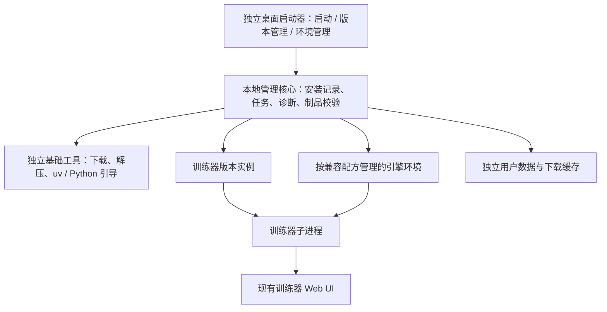

# 桌面启动器参考项目调研

调研日期：2026-10-28。需求依据：[issue #516：独立桌面启动器](https://github.com/wochenlong/lora-scripts-next/issues/516)。

本轮结论：建议以 **Tauri 2 + Vue 3 + TypeScript + Rust** 为优先验证方向，组合借鉴多个项目。绘心适合研究桌面壳和事件桥接；三月七小助手适合研究 Windows 更新流程；Stability Matrix 适合研究多引擎与独立环境；新版 Comfy Desktop 适合研究多安装、旧安装接管和快照恢复。若更看重直接复用 TypeScript 后端代码与交付速度，**Electron + Vue 3** 是更顺畅的备选。

上述为调研建议，尚未锁定实施选型。候选项目的安装器、GUI、构建和 GPU 功能均未在本轮运行；“源码已实现”只表示找到了实现入口。

## 1. 本地基线与本轮边界

| 项目 | 核验结果 |
| --- | --- |
| 工作副本 | `E:/OpenSourceTeamWork/workspace/branches/dev` |
| 分支 | `dev` |
| 同步 | 使用代理执行 `pull --ff-only origin dev`，快进 40 个提交 |
| 同步前 | `4653b1e9732b792e87c405dd9846fb4d7d4672ea` |
| 同步后 | `9ca2de963122f34599e34e5ff382199de9188811` |
| VERSION | `3.3.1-dev` |
| 原有本地文件 | 32 个未跟踪文件已备份，同步后逐项 SHA256 一致 |
| 项目改动 | 新增本报告；没有实施启动器业务代码 |

调研源码副本及版本清单位于 `E:/OpenSourceTeamWork/workspace/tools/launcher-research-20261028/`，其中 `source-snapshots.json` 记录来源、分支和固定提交。备份为同目录的 `dev-untracked-before-pull.zip` 和 `.json` 清单。上述参考仓库通过稀疏克隆读取，没有安装其依赖或执行其程序。

本轮按 Lite research/prototype（轻量调研）处理，采用需求对照和源码证据，不进入完整施工计划、开发、发布流程。

## 2. #516 的筛选标准

选择样板时，优先看以下能力，而非界面与绘世是否相似：

1. **启动器独立存活**：没有系统 Python，或训练器代码、Python、依赖损坏时，仍能打开并执行恢复。
2. **从零安装**：用户只有启动器时，能选路径、看到下载内容和预计空间，分阶段安装并重试。
3. **版本实例管理**：稳定线与开发线分开；版本以固定制品/提交标识；多版本共存；保留上一可用版本。
4. **按组件检查与修复**：区分训练器本体、各引擎、硬件问题；实际探测文件和解释器，不单看状态文件。
5. **可靠变更**：下载校验、临时安装、失败恢复、保留用户数据；切换版本不应再次下载同一份已完整安装的版本。
6. **符合本项目交互范围**：侧栏仅“启动、版本管理、环境管理”，约 900×600，中性灰工程风。

## 3. 候选对照与复用优先级

“可复用代码”均以遵守相应许可证、保留署名与许可文本为前提；跨语言时主要复用设计。许可按本轮读取的仓库原文或包元数据描述。

| 项目 | 技术栈 / 许可 | 最值得借鉴 | 与 #516 的距离 | 建议 |
| --- | --- | --- | --- | --- |
| [绘心 HuixinLauncherTemplate](https://github.com/XnneHangLab/HuixinLauncherTemplate) | Tauri 2 / React 18 / Rust；Cargo 明确 `UNLICENSED`，未见 LICENSE | Rust 命令层、JSON 行事件、下载队列、日志、子进程生命周期 | 依赖外部目标项目；版本管理和疑难解答是占位页；没有完整恢复层 | **重点结构样板**；现有许可不支持直接视作开源代码底座 |
| [三月七小助手](https://github.com/moesnow/March7thAssistant) | Python / PySide6 / Fluent Widgets / PyInstaller；仓库 GPLv3 | 独立更新程序、下载与覆盖分阶段、文件占用、取消重试、国内渠道、只读配置 | 当前主要是整包/更新包覆盖；没有训练引擎隔离及多版本目录切换 | **重点更新工程样板** |
| [Stability Matrix](https://github.com/LykosAI/StabilityMatrix) | C# / Avalonia；源码 AGPLv3，官方二进制另有 EULA | 多应用包、独立 Python/venv、安装步骤、可恢复下载、Kohya/OneTrainer/AI Toolkit 适配 | 功能范围远大于启动器；不宜搬入推理、模型商城等部分 | **最值得研究的多环境管理底座** |
| [新版 Comfy Desktop](https://github.com/Comfy-Org/Comfy-Desktop) | Electron / Vue 3 / TypeScript；AGPLv3-or-later 或商业许可二选一 | 多安装、已有安装探测、独立引导工具、快照恢复、下载/解压阶段与锁 | 需要移除 Comfy 专属安装源、节点、推理等耦合 | **Electron 路线首选源码样板** |
| [Invoke Launcher](https://github.com/invoke-ai/launcher) | Electron / React / TypeScript；Apache-2.0 | 捆绑 uv、自管 Python/venv、安装向导、GPU/源选择、日志 | Repair Mode 会重装 Python、删除 venv；需改为符合 #516 的精确修复策略 | **首次安装与 uv 引导首选参考** |
| [Modrinth App](https://github.com/modrinth/code) | Tauri 2 / Rust / Vue 3；相关 App 包 GPL-3.0-only，品牌素材另限 | 实例管理、安装任务、暂停/恢复/重试命令、桌面命令边界、进程管理 | 面向 Minecraft，Python/CUDA/引擎诊断要自行实现 | **Tauri + Vue 路线的成熟结构参考** |
| [licyk All In One Launcher](https://github.com/licyk/sd-webui-all-in-one-launcher) | Windows PowerShell WPF / Bash；GPLv3 | 项目注册表、多下载源重试、代理模式、安装脚本调用 | 多数实际安装逻辑在上游脚本；不是完整的多版本恢复管理器 | **国内网络与安装配方参考** |
| [Pinokio](https://github.com/pinokiocomputer/pinokio) | Electron / JavaScript；桌面壳 MIT | 声明式安装/运行配方、运行目录与 venv 隔离 | 通用 AI 应用平台，范围过大；核心逻辑另在 pinokiod | **配方模型参考，优先级次于前述项目** |
| 绘世 / 秋叶启动器 | 社区资料显示为 .NET 桌面程序；本轮未确认可复用的原始源码许可 | 环境维护、核心/扩展版本、诊断到修复入口、代理设置 | 不能从使用文档确认内部实现或获得源码复用许可 | **功能与交互标杆** |

旧的 [Comfy-Org/desktop](https://github.com/Comfy-Org/desktop) 已归档，GitHub 描述指向新版 `Comfy-Org/Comfy-Desktop`。旧版为 GPLv3，不应与新版的仓库、架构和许可混为一谈。

## 4. 绘心：最接近轻量桌面壳的具体样板

核对版本：`c676ab1b2f76ea60e44f3bb2e9b57fd17d448e3f`。实际代码为 Tauri 2 + React 18 + TypeScript，Rust 后端。

### 4.1 已有实现及可以借鉴的结构

| 源码入口 | 已看到的实现 | 本项目可采用的思路 |
| --- | --- | --- |
| `src-tauri/src/lib.rs` | 注册命令、管理共享状态、退出时清理受管 WebUI | 壳生命周期与业务命令分开 |
| `src-tauri/src/runtime/commands.rs` | 环境探测、选工作目录、下载入队、日志导出、启动 WebUI | 将 UI 操作收敛成类型明确的桌面接口 |
| `src-tauri/src/runtime/process.rs` | 启动 Python、读取 stdout/stderr、解析事件、管理子进程 | Rust 管进程，Python 工具返回结构化事实 |
| `src-tauri/src/runtime/state.rs` | `Arc<Mutex<...>>`、串行队列、运行记录、任务状态 | 防止并发安装互相踩文件；切目录时检查活动任务 |
| `src/services/runtime/bridge.ts` | Tauri invoke 与事件监听的集中封装 | Vue 页面也可采用同样的桥接边界 |
| `src/services/runtime/runtime.ts` | 环境、资源、任务、进度的类型与归并函数 | UI 从事实生成状态，而非解析日志中的文字 |

这里有实际命令实现，不能只归类为静态页面模板。下载命令会调用外部 Python CLI；Rust 把 Python JSON 行事件转成 `runtime:event`，原始输出走 `runtime:raw-log`。这套“结构化事件 + 原始日志”的分工很适合安装器。

### 4.2 对照 #516 的具体缺口

| #516 能力 | 当前源码事实 | 对本项目的影响 |
| --- | --- | --- |
| 首次只有启动器也能安装 | 默认调用 PATH 中的 `uv`，执行 `uv run --no-sync python`；业务命令为 `xnnehanglab_tts.cli` | 要新增独立 bootstrap（基础工具引导），不能要求训练器环境先正常 |
| 安装位置与可移动性 | `resolve_repo_root()` 根据编译期 `CARGO_MANIFEST_DIR` 向上两级取路径 | 打包后应以实际安装记录/可执行程序位置解析，不能沿用构建机路径 |
| 环境坏了仍能下载修复 | `inspect_runtime` 和 `enqueue_download` 先要求 `ensure_environment_ready()`；只有 `torch-cpu-ready` / `torch-gpu-ready` 可继续 | 修复通道必须能在 Torch 不可用时工作 |
| 版本列表、切换、回退 | `src/app/routes.tsx` 中 `versions` 返回 `PlaceholderPage` | 有导航名称，尚无版本管理实现 |
| 每引擎检查与单项修复 | `troubleshooting` 返回 `PlaceholderPage`；探测面向目标 TTS 项目 | 需新建引擎 manifest、诊断和修复计划 |
| 重启后恢复安装任务 | `QueueState` 是内存里的 `Vec` / `VecDeque` | 需持久化任务日志及现场核对，不能把旧内存状态当实际进度 |
| 暂停、取消、恢复 | 类型中有 `cancelled`，命令注册中未见完整的暂停/取消/恢复操作 | 类型枚举不能作为完整控制能力的证据 |
| 启动成功判定 | `spawn_webui_process()` 创建子进程并读日志；该流程未见 HTTP 健康检查 | 应等训练器响应健康探测后再显示可用 |
| 进程边界 | `launch_webui()` 调用 `cleanup_webui_port_conflicts(..., 7860)`，会终止该端口监听进程 | 应识别所属安装/进程；无归属冲突应提示或换端口 |
| 视觉与窗口 | 默认 1440×900、最小 1100×760；侧栏多项，蓝色渐变、插画、大圆角 | 需按 #516 重做三栏与 900×600 布局 |
| 可直接复制代码 | `src-tauri/Cargo.toml` 第 6 行为 `license = "UNLICENSED"`，源码树未见 LICENSE | 本轮只建议借鉴设计；若要引入代码，需要明确的使用授权 |

固定提交证据：[Cargo 与许可](https://github.com/XnneHangLab/HuixinLauncherTemplate/blob/c676ab1b2f76ea60e44f3bb2e9b57fd17d448e3f/src-tauri/Cargo.toml#L6)、[命令与环境前置检查](https://github.com/XnneHangLab/HuixinLauncherTemplate/blob/c676ab1b2f76ea60e44f3bb2e9b57fd17d448e3f/src-tauri/src/runtime/commands.rs)、[Python 命令与端口处理](https://github.com/XnneHangLab/HuixinLauncherTemplate/blob/c676ab1b2f76ea60e44f3bb2e9b57fd17d448e3f/src-tauri/src/runtime/process.rs)、[编译期路径与队列](https://github.com/XnneHangLab/HuixinLauncherTemplate/blob/c676ab1b2f76ea60e44f3bb2e9b57fd17d448e3f/src-tauri/src/runtime/state.rs)、[占位路由](https://github.com/XnneHangLab/HuixinLauncherTemplate/blob/c676ab1b2f76ea60e44f3bb2e9b57fd17d448e3f/src/app/routes.tsx)、[窗口配置](https://github.com/XnneHangLab/HuixinLauncherTemplate/blob/c676ab1b2f76ea60e44f3bb2e9b57fd17d448e3f/src-tauri/tauri.conf.json)。

结论：绘心能帮助确定桌面壳、进程桥接和事件协议的组织方式，完整的分发、版本、环境恢复层仍需设计。React 组件不适合直接迁入现有 Vue 工程；协议与纯逻辑更值得复用其思路。

## 5. 三月七小助手：Windows 更新工程参考价值很高

核对版本：`7cf6c6bed474539485d3b1504077ac352866829f`。它的 GUI 是 **Python + PySide6 + Fluent Widgets**，通过 PyInstaller 打包；并非 Electron 或 Tauri。

### 5.1 推荐重点借鉴的实现

1. **准备阶段与最终覆盖分开**：GUI 先下载、校验、解压，再启动独立的 `March7th Updater.exe --mode finalize --wait-pid ...`。更新器等待主进程退出，处理 Windows 可执行文件被占用的问题。
2. **更新器自己保持轻依赖**：`March7th Updater.spec` 是单独 EXE，入口转入 `module/update/helper_app.py`，更新窗口使用 Win32 API；不用再启动完整的 Qt GUI 执行最终覆盖。
3. **更新器不参与写用户配置**：`updater.py` 在导入其他模块之前设置 `MARCH7TH_CONFIG_READONLY=1`，明确规避主程序退出保存与更新器启动之间的配置竞争。
4. **阶段、错误、重试可见**：共享 `UpdateEngine` 提供阶段与进度回调；UI 有失败重试、取消、后台下载、准备完成后再安装的流程；文件占用能报告到具体路径。
5. **下载可恢复**：`downloader.py` 有 HTTP Range 续传、重试、aria2 回退、取消、SHA256 检验；哈希来源为空时会跳过校验，本项目应由制品清单明确约束。
6. **渠道对齐版本**：GitHub 与 Mirror酱分开处理；GUI 检查镜像渠道版本是否与目标一致，避免同名渠道实际提供不同版本。
7. **打包区分更新包和完整包**：CI 分别生成核心更新包及包含第三方内容的完整包，可借鉴“应用代码更新”与“重型运行资源下载”分开交付的策略。
8. **单实例与路径处理**：GUI 使用基于程序路径的 `QLocalServer` 标识，同一路径单实例；冻结打包后以实际可执行文件目录为工作目录。

### 5.2 需要重新设计的部分

- 更新核心是**对当前目录逐文件覆盖**。虽然有暂存、文件比较、占用检查及更新器自身 `.old` 备份，仍不能等价为“完整版本快照 + 一键回退”。`os.replace` 失败时存在退回 `copy2` 的非原子路径。
- `terminate_processes()` 按进程名称扫描终止；本项目应绑定自己启动的安装实例与进程身份，避免影响其他安装。
- 当前 Launcher/Updater 打包使用 `uac_admin=True`，适配它的游戏自动化场景。训练器启动器应优先普通用户目录，只在确有需要的系统操作上单独处理权限。
- 它的 GUI 和打包库包含业务运行依赖，与 #516 要求的“训练器整个目录损坏时仍能独立修复”有距离。独立更新 EXE 的思路有价值，不能据此断言已满足完整恢复要求。
- 仓库 GPLv3 不代表所有依赖和素材都同一许可；若选择 Fluent Widgets 等组件，应继续核对对应组件与素材许可。

源码入口：[更新器入口](https://github.com/moesnow/March7thAssistant/blob/7cf6c6bed474539485d3b1504077ac352866829f/updater.py)、[更新引擎](https://github.com/moesnow/March7thAssistant/blob/7cf6c6bed474539485d3b1504077ac352866829f/module/update/update_engine.py)、[下载器](https://github.com/moesnow/March7thAssistant/blob/7cf6c6bed474539485d3b1504077ac352866829f/module/update/downloader.py)、[原生更新窗口](https://github.com/moesnow/March7thAssistant/blob/7cf6c6bed474539485d3b1504077ac352866829f/module/update/helper_app.py)、[GUI 更新流程](https://github.com/moesnow/March7thAssistant/blob/7cf6c6bed474539485d3b1504077ac352866829f/module/update/update_window.py)、[更新源检查](https://github.com/moesnow/March7thAssistant/blob/7cf6c6bed474539485d3b1504077ac352866829f/app/tools/check_update.py)、[发布流水线](https://github.com/moesnow/March7thAssistant/blob/7cf6c6bed474539485d3b1504077ac352866829f/.github/workflows/1.build_release.yml)。

结论：推荐把它作为“Windows 上如何把更新做稳、让失败可解释”的重点参考。采用 Tauri 并不妨碍借鉴这些流程和状态模型。

## 6. 其余项目应具体看哪里

### Stability Matrix

固定提交：`87dced77c1980e73c467dfac67009a94a9aa3d90`。

- `StabilityMatrix.Core/Models/Packages/BasePackage.cs` / `BaseGitPackage.cs`：下载、安装、更新、启动、共享目录的统一包接口。
- `Models/Packages/KohyaSs.cs`、`OneTrainer.cs`、`AiToolkit.cs`：训练工具适配，不只覆盖绘图 WebUI。
- `Models/PackageModification/PackageModificationRunner.cs`：分步执行、当前步骤、异常与进度输出。
- `Python/PyVenvRunner.cs`：Python 虚拟环境命令管理。
- `Models/TrackedDownload.cs` / `Services/TrackedDownloadService.cs`：下载跟踪、暂停恢复、队列与可选预期 SHA256。

[Core 源码](https://github.com/LykosAI/StabilityMatrix/tree/87dced77c1980e73c467dfac67009a94a9aa3d90/StabilityMatrix.Core)。建议借鉴 `EnginePackage`（引擎包）与 `InstalledInstance`（已安装实例）分开建模，以及分步变更。选择 Rust 时，需要将 C# 设计转成自己的实现。

### 新版 Comfy Desktop

固定提交：`524b62195695bd8bb0d3dc8ddcd4a07cc85f9ef3`。

- `src/main/installations.ts`：安装记录、状态、路径与旧配置迁移。
- `src/main/sources/standalone/install.ts`：隔离环境安装、已有安装探测和环境布局迁移。
- `src/main/lib/installer.ts` / `download.ts`：下载/解压分阶段、并发下载锁与取消。
- `src/main/lib/pythonEnv.ts`：按安装记录解析 Python/uv/venv。
- `src/main/lib/snapshots/restore.ts` / `store.ts`：版本、依赖与节点的恢复；恢复失败时处理回退。
- `src/main/lib/snapshots/AGENTS.md`：非常有价值的约束——导入的恢复目标先暂存，只有恢复成功才能写入真实历史；失败不能让目标状态冒充当前状态。

[主进程源码](https://github.com/Comfy-Org/Comfy-Desktop/tree/524b62195695bd8bb0d3dc8ddcd4a07cc85f9ef3/src/main)、[LICENSE 原文](https://github.com/Comfy-Org/Comfy-Desktop/blob/524b62195695bd8bb0d3dc8ddcd4a07cc85f9ef3/LICENSE)。GitHub API 的许可识别为 `NOASSERTION`，但原文明确提供 AGPL 选项，因此不能误判为“不是开源、不能复用”。

### Invoke Launcher

固定提交：`dc1947b88365d0f631ef3af77e3634926d18b58a`。

重点看 `download_uv.ts`、`src/main/install-manager.ts`、`invoke-manager.ts`、`updater.ts` 与 `src/renderer/features/InstallFlow/`。它把 uv 随桌面应用交付，再管理 Python 和 venv，能减少对系统环境的依赖。安装向导包含位置、版本、GPU 配置、复核与执行阶段。

[安装管理源码](https://github.com/invoke-ai/launcher/blob/dc1947b88365d0f631ef3af77e3634926d18b58a/src/main/install-manager.ts)。其 Repair Mode 是较强的重建手段，应作为后备方案；本项目默认应先提供按诊断结果修补单项的计划。

### Modrinth App

固定提交：`2c6b0c64bbafdd22dc6f478541d74acfc89207bb`。

`apps/app` 为 Tauri/Rust 壳，`apps/app-frontend` 为 Vue 3 前端，`packages/app-lib` 为业务库。重点看 `apps/app/src/api/install.rs` 与 `process.rs`：安装预览、创建实例、查询任务、暂停、恢复、重试、取消与进程操作分成明确命令。

[App 接口](https://github.com/modrinth/code/tree/2c6b0c64bbafdd22dc6f478541d74acfc89207bb/apps/app/src/api)、[复制说明](https://github.com/modrinth/code/blob/2c6b0c64bbafdd22dc6f478541d74acfc89207bb/COPYING.md)。适合参考 Tauri 的分层与实例模型，Minecraft 账号、内容商城等功能不属于本项目范围。

### licyk 与 Pinokio

- licyk 固定提交 `81da884104fdecd5b9b418e0f0bb98a82b113114`。重点看 `gui/registry.ps1`、`config.ps1`、`runtime.ps1`，分别对应项目清单、代理/参数和下载执行。当前 GUI 为 PowerShell WPF；不是 Tauri。可借鉴 `auto/manual/off` 代理模式和按顺序尝试下载源。[源码](https://github.com/licyk/sd-webui-all-in-one-launcher/tree/81da884104fdecd5b9b418e0f0bb98a82b113114/gui)。
- Pinokio 壳固定提交 `0765ab1c24eee9bf7acf1618b94e1cfdc52886fc`，MIT。核心运行库另在 pinokiod，本轮读取的提交为 `add4a674ad1ba95bb62ec427fce519fe5bf0e9bf`，其 `package.json` 声明 MIT，源码树未见独立 LICENSE 文本。重点参考 `shell.run` 的 `path` / `venv` 配方结构；目录约定不能视为操作系统沙箱。[内核入口](https://github.com/pinokiocomputer/pinokiod/blob/add4a674ad1ba95bb62ec427fce519fe5bf0e9bf/kernel/api/shell/index.js)。

## 7. 绘世适合借鉴哪些产品行为

本轮证据主要来自 [SD Note 社区使用文档](https://sdnote.netlify.app/sd_launcher/)，包括 [环境维护](https://sdnote.netlify.app/sd_launcher/advance/env/)、[版本管理](https://sdnote.netlify.app/sd_launcher/ver_manager/) 和 [故障处理](https://sdnote.netlify.app/help/sd_launcher/)。这是社区文档，不是本轮取得的官方源代码。

值得保留的是：环境维护有具体操作；区分 Python/Git 原生组件与 Python 软件包；版本管理覆盖核心与扩展；代理作用范围可解释；把错误与修复入口关联。

本项目应按 #516 把常见修复放在直接可见的位置。绘世文档中部分操作藏在专家模式，而且整合包与启动器创建环境的处理路径不同；我们的安装记录应描述环境来源，避免让用户自己判断应该卸载哪套 Python。

## 8. 结合当前 dev，应怎样吸收这些经验

当前仓库已经有独立引擎目录、manifest、环境安装/检查、漂移依赖补装、下载源策略与 portable 更新脚本。可参考：

- `mikazuki/engines/registry.py`：发现引擎包。
- `mikazuki/engines/kohya/environment.py`：依赖约束、漂移计算与增量升级命令。
- `mikazuki/engines/kohya/extension_state.py`：实体检查、主环境回退审计、状态与漂移信息。
- `mikazuki/engines/kohya/routes.py` / `installer.py`：状态、安装、修复、升级和任务执行入口。
- `scripts/portable/launch_portable.bat`：嵌入式 Python、首次依赖验证与恢复分支。

这些代码能提供引擎知识，仍需把可恢复管理层移到训练器进程之外：现有 HTTP routes 和部分 installer 依赖训练器的任务管理与运行环境，训练器启动不了时不能只靠调用这些接口恢复。

建议结构：

建议把下列规则带入后续设计：

1. **代码版本与引擎环境分别记录**。同一引擎环境能否复用，取决于 Python、Torch、平台和完整依赖配方；不能让所有版本共用一个任意升级的 venv。
2. **开发线也使用固定身份**。记录 commit SHA 与制品/依赖摘要，不能只记一个随时间变化的 `dev` 名称。
3. **更新先准备，成功后切换**。下载与安装新版本时保留现有可用实例，健康检查通过后才更新当前实例指针；保留上一可用实例。
4. **回退覆盖运行环境兼容性**。只回退 Python 源码，未必能回退已经升级的依赖和用户配置格式。应建立版本与环境的对应关系，并约束数据迁移。
5. **Windows 路径与文件锁单独验证**。venv、脚本或本地扩展可能含绝对路径；不能假设把完整环境从临时目录重命名到最终目录一定可用。应按最终路径创建/验证，或采用验证过的可重定位运行时方案。
6. **修复先生成计划**。诊断结果列出损坏组件、实际证据和建议动作，默认补装/替换最小集合；环境重建另列为后备动作。
7. **实际事实优先于状态文件**。状态丢失时发现解释器、查询依赖和运行探测，重建记录；不能立即判成未安装。
8. **GPU 诊断分层**。区分显卡与驱动、驱动支持的 CUDA 上限、Torch 自带 CUDA、`torch.cuda.is_available()` 的实际结果；不能仅凭缺少系统 CUDA Toolkit 或 `nvcc` 判定训练环境不可用。
9. **启动成功以服务响应为准**。受管进程存活、端口监听、训练器语义健康检查共同确认；修复成功也应重新执行对应探测。

## 9. 技术路线建议与待验证点

| 路线 | 与现有项目的关系 | 成本与限制 | 本轮建议 |
| --- | --- | --- | --- |
| Tauri 2 + Vue 3 + Rust | 延续 Vue/TS；原生核心独立于训练器 Python | 要实现 Rust 侧管理核心；Windows 依赖 WebView2；Electron TS 逻辑需移植或另设工具 | **优先做最小可行性验证** |
| Electron + Vue 3 + TypeScript | 新 Comfy Desktop 与本项目 Vue/TS 接近；Invoke 的 TS 安装逻辑也好参考 | 自带 Chromium/Node，体积与基础内存通常更大 | **交付速度优先时的备选** |
| .NET / Avalonia 或 Windows WPF | Stability Matrix 的 C# 核心复用空间更大 | 引入新的 UI 栈；自包含分发需计入 .NET 运行时成本 | 团队明确选择 C# 时再考虑 |
| PySide6 独立打包 | 三月七提供完整的 Windows 发布实践；Python 业务接入方便 | 要把启动器 Python/Qt 与训练器环境彻底隔离，并控制依赖与包体 | 技术上可行，本轮不列第一选择 |

不能把“Tauri 小”直接承诺为固定几 MB。[官方 Windows 安装文档](https://v2.tauri.app/distribute/windows-installer/)明确：WebView2 缺失时需要下载或随包提供；离线安装器与固定运行时会明显增加体积。本轮没有构建样包测量。

[Tauri updater 文档](https://v2.tauri.app/plugin/updater/)要求更新签名，而且该插件主要解决启动器自身更新。训练器版本列表、多实例切换、引擎环境与回退，仍是本项目自己的管理逻辑。

## 10. 本轮验证记录与唯一下一步

| 验证项 | 状态 | 证据 / 说明 |
| --- | --- | --- |
| dev 同步、远端提交一致 | pass | `pull --ff-only` 成功；HEAD 与远端 `refs/heads/dev` 一致 |
| 原有未跟踪文件保留 | pass | 32 文件备份与同步后 SHA256 对照 |
| issue 需求与源码对照 | pass | 本报告需求、项目表及两个重点项目逐项分析 |
| 来源版本可复查 | pass | `source-snapshots.json`、正文固定提交链接 |
| 候选启动器安装/GUI/构建 | not-run | 本轮为源码调研，不是可运行交付验收 |
| GPU、干净机器、损坏恢复实测 | not-run | 后续原型的必测项，本轮不作通过声明 |
| 业务单元/集成测试 | not-applicable | 本轮没有业务实现改动 |

本轮调研完成。尚未实施的启动器功能属于后续工作，不构成本轮源码调研的已验证能力。

**下一步：完成一个 Tauri 2 + Vue 3 的最小验证样包，验证“没有系统 Python/uv、训练器目录不存在或损坏时，启动器能打开、选择路径、独立引导基础工具并恢复训练器”，据此决定是否锁定 Tauri 路线。**
