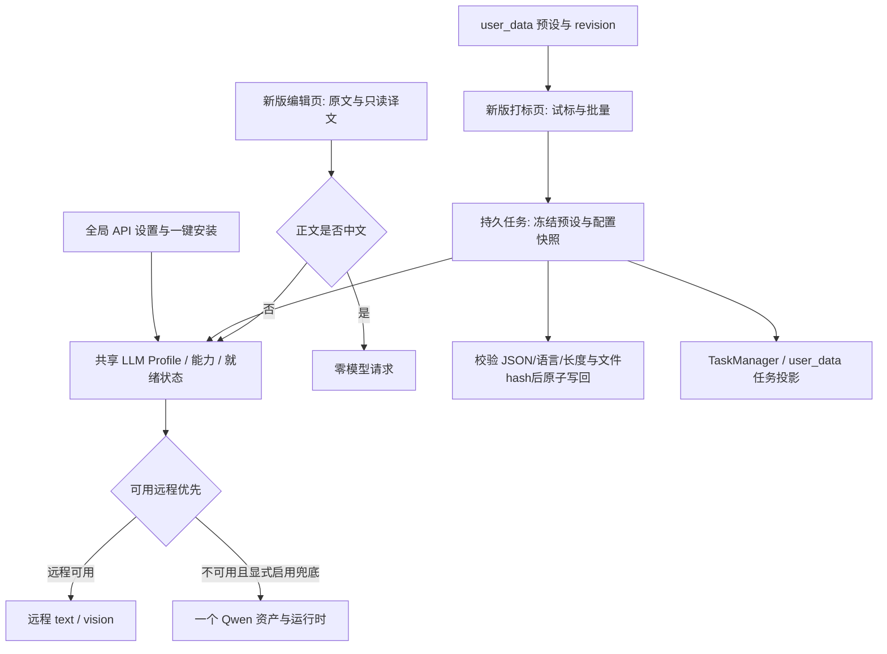

# 最新 dev 适配与统一 Qwen 本地模型设计增量

> CC-06（2026-10-11，用户最新明确决策）：直接选定Qwen3.5-2B，不再进行U1选型/可行性对比探针。默认Unsloth Q4_K_M + 同revision F16 mmproj + b11327；AC-U1采用用户指定选型通过，探针为waived_by_user，质量/资源不能声称已验证。U4/U5功能、真实链路和从零验收仍执行。见U1/user-selection.json与selection-decision.md。

2026-10-10，计划 `DATASET-NL-DEV-UNIFICATION-20261010`，设计已收敛、实施未开始。本增量覆盖[既有设计](natural-language-captioning-tagging-design.md)中与新 dev UI、模型选择、验收口径冲突的部分；不抹除旧实现历史。

规范性详细方案与需求到测试映射统一放在[实施验收计划](../tasks/nl-caption-dev-unification-plan/01_目标计划书/01_适配与模型统一实施验收计划.md)。进度只写入[主任务书](../tasks/natural-language-captioning-task-book.md)。

## 端到端数据流

## 固定产品行为

采用 dev 的全宽主区、参数侧栏、方法/来源/模型行、托管数据集选择器、全局下载源和图库编辑布局；恢复真实 Caption/API 能力。不得整页退回旧布局，也不得只启用 disabled 按钮。

语言、详略、格式由预设的元数据和完整 user/system 模板共同控制。默认英文；英文提示词整体英文。切换预设有草稿保护，用户自定义提示词不静默翻译或覆盖；预设声明与正文指令明显冲突时提示修正，执行后仍校验真实输出语言。重试采用原始快照，预设后改不污染旧任务。

LLM 配置只有一个权威。`/settings/api` 连接共享 `/api/llm/*`；旧翻译接口仅适配，不保存第二份配置或明文 Key。前端显示远程优先及本地兜底状态；不得用页面上的“本地”选择绕过共享远程优先策略。允许本地连接/能力测试，测试与生产路由明确分开。没有远程且用户已启用本地时才以本地执行；模型实测在隔离环境通过此配置达成本地验证。

一个模型资产 ID 对应主 GGUF、匹配 mmproj、运行时及 text/vision/language 声明。选型优先比较 Qwen3.5-2B 与 Qwen3-VL-2B；0.8B 只在需要更低内存时进入候选，不预设胜者。安装完成必须通过两种能力的健康探测，单有文件不能 ready。一个受控进程、共享生命周期、有界排队；取消一个请求不得错误取消另一个。

自然语言原文进入 raw 编辑模式，中文译文独立只读，中文正文免调用。Tag 模式仍保留词典与Tag操作；raw 是展示选择，不是随意更改文件格式依据。自然语言/unknown/历史mixed使用服务端来源与保守保护，批量路径同样检查。

## 数据与兼容

`user_data/presets` 为唯一物理预设存储；兼容旧 `/api/llm/prompt-presets`，保留完整模板/语言/长度/能力/revision，训练类别隔离。导入先展示预览，显式确认后原子提交；重复导入不重复生成，失败不提前删除旧数据或标记完成。

Caption SQLite 保持任务执行/恢复权威，dev TaskManager与`user_data/tasks`接收统一投影。停止、隐藏、历史删除、标注回滚各自定义，不互相借用；写盘先校验hash，失败/取消不留部分caption。

远程请求发送受限 JPEG data URL，移除 EXIF、本地路径和数据集标识；Key只通过后端运行时注入。迁移旧明文Key时不复制进新的备份/日志；原用户文件不擅自删改，采用脱敏迁移快照并要求运行时重输。

## 交付标准

U0 合并冻结、U1实测选型、U2共享后端、U3新UI、U4完整回归与真实链路、U5从零隔离重建、U6新沙盒交付。完成U6且全部硬门pass后可关闭goal，用户手验留作后续。旧可选远程、旧平台豁免、旧人工评分不作为本轮新版本完成凭据。
